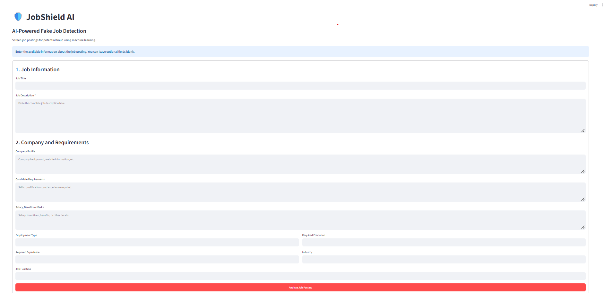

# 🛡️ JobShield AI — Fake Job Detection System

An AI-powered job screening application that uses machine learning and text analysis to identify potentially fraudulent job postings.

## 📌 Project Overview

Online job scams can expose job seekers to financial fraud and misuse of personal information. JobShield AI analyzes job posting text and predicts whether a listing is likely legitimate or potentially fraudulent.

The application combines a trained machine-learning model with a simple warning-sign checklist to help users assess suspicious job advertisements.


## 🖥️ Application Preview




## ✨ Features

- Machine-learning-based fake job classification
- TF-IDF text feature extraction
- Logistic Regression classification
- Fraud risk score and configurable decision threshold
- Warning indicators for suspicious phrases
- Interactive Streamlit web interface
- Practical job-safety recommendations

## 🧰 Technologies Used

- Python
- Pandas and NumPy
- Scikit-learn
- TF-IDF Vectorizer
- Logistic Regression
- Matplotlib
- Streamlit
- Joblib
- BeautifulSoup

## ⚙️ How It Works

1. Collect and preprocess job-posting data.
2. Clean and combine relevant text fields.
3. Convert text into numerical features using TF-IDF.
4. Train and evaluate a Logistic Regression model.
5. Predict the likelihood of fraud-related classification.
6. Display the result, estimated risk score, and potential warning signs.

## 📊 Model Evaluation

The current model achieved approximately **97.34% test accuracy**.

On the held-out test set, the fraudulent class had approximately:
- Precision: 69%
- Recall: 83%
- F1-score: 75%

The dataset is imbalanced, so accuracy alone does not describe the model's performance. The model may miss some fraudulent postings and may incorrectly flag legitimate ones.

## 🚀 Run Locally

### 1. Clone the repository

```bash
git clone YOUR_GITHUB_REPOSITORY_URL
cd JobShield
```

### 2. Create and activate a virtual environment

Windows:

```bash
python -m venv venv
venv\Scripts\activate
```

### 3. Install dependencies

```bash
pip install streamlit scikit-learn pandas numpy matplotlib beautifulsoup4 joblib
```

### 4. Launch the application

```bash
python -m streamlit run app.py
```

Open the local URL displayed in your terminal.

## 📁 Project Structure

```text

JobShield/
├── app.py
├── README.md
├── requirements.txt
├── .gitignore
├── models/
│   ├── jobshield_model.pkl
│   ├── tfidf_vectorizer.pkl
│   └── threshold.pkl
├── notebooks/
│   └── 01_data_exploration.ipynb
└── src/
    ├── data_preprocessing.py
    ├── explain.py
    ├── feature_engineering.py
    ├── predict.py
    └── train_model.py

```

## ⚠️ Limitations

- Predictions depend on the training dataset and learned text patterns.
- Risk scores are not calibrated probabilities.
- Warning indicators are basic keyword-based checks.
- A low score does not guarantee that a job is genuine.
- Users should independently verify employers and never pay suspicious recruitment fees or share sensitive credentials.

## 🎯 Future Improvements

- Improve model performance on fraudulent listings.
- Add more explainable model predictions.
- Evaluate additional classification algorithms.
- Add a job-posting history and downloadable reports.
- Deploy the application online.

## 👩‍💻 Project Purpose

Developed as a Python and Data Science mini project to explore natural language processing, supervised machine learning, model evaluation, and interactive application development.
